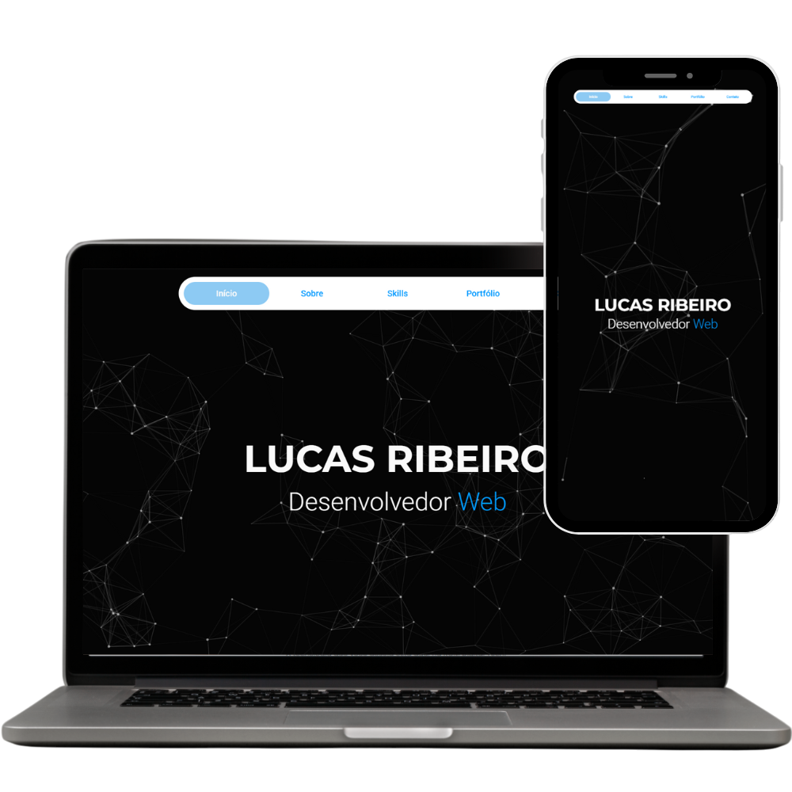

# Personal Portfolio



Source code of my personal portfolio website, live at **[lucasribeirodev.netlify.app](https://lucasribeirodev.netlify.app/)**.

Built with plain HTML, CSS and JavaScript, no framework, as an early front-end project.

## Features

- Responsive layout for mobile and desktop
- Light/dark theme toggle
- Scroll animations (AOS) and interactive background (Particles.js)
- Contact form that sends emails through EmailJS
- SEO meta tags

## Tech stack

HTML5 · CSS3 · JavaScript · AOS · Particles.js · Font Awesome · EmailJS · Netlify

## Running locally

No build step. Clone the repo and open `index.html` in your browser, or serve the folder:

```bash
npx serve .
```

## Contact

[LinkedIn](https://www.linkedin.com/in/lucas-ribeiro-7218a0153/) · [lucas.mribeiro.dev@gmail.com](mailto:lucas.mribeiro.dev@gmail.com)
